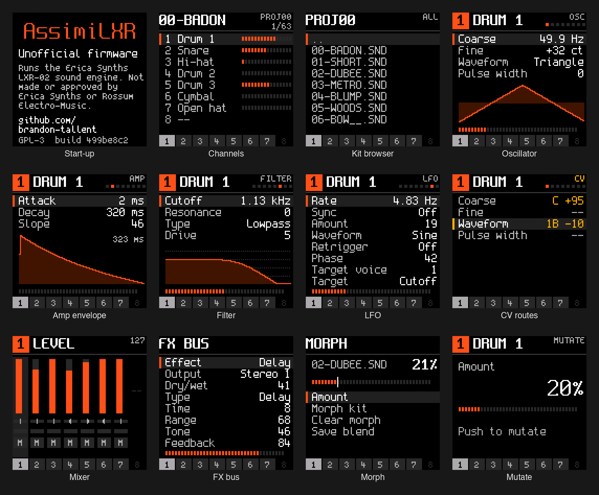

# AssimiLXR



Unofficial firmware for the Rossum Electro-Music Assimil8or that turns it
into an eight-voice drum synthesizer running the Erica Synths LXR-02 sound
engine:

* Eight channels, each its own LXR voice (Drum, Snare, Cymbal, Hi-hat or
  open Hi-hat) with its own sound, on its own output.
* LXR-02 kits (`.snd`) load straight from the card; AssimiLXR kits (`.kit`)
  keep all eight channels, and a channel saves back to an LXR-02 kit.
* Morph between two kits per channel, from the panel, MIDI or CV.
* A mixer and the LXR's FX bus, with the reverb the LXR-02 leaves out.
* Bipolar CV control of any sound parameter from any of the 24 CV inputs;
  gates, 1V/oct pitch and accent inputs per channel.
* External audio through the FX bus from the Sample inputs.
* Your own oscillator waveforms and transients from the card.
* The LXR-02's MIDI implementation, plus Chroma 8 and General MIDI drum
  notes, and MIDI clock for the LFOs and delay.

Rossum's software stays on the module and comes back from the Utilities
menu.

See the [manual](https://brandon-tallent.github.io/assimilxr/manual.html)
for what's different from the LXR-02 and how the panel works. The
[LXR-02 manual](https://www.ericasynths.lv/drum-synthesizer-lxr-02-1132/)
covers the sound engine.

## Installing

1. Copy `app` from the release to the top level of your micro SD card.
2. With the card in the front panel slot, use **Utilities > Load Software**
   and restart as for any software update.
3. The display shows the AssimiLXR start-up screen.

On its first start AssimiLXR keeps a copy of the Rossum software it
replaced. Kits go in an `AssimiLXR` folder on the card, which is created
when missing.

## Going back

**Utilities > Firmware > Stock firmware** puts back the Rossum software
AssimiLXR replaced and restarts. Leave AssimiLXR's `app` on the card to
return with **Load Software**.

## Building

```sh
make
```

`build/app` is the release file. The build expects the Arm GNU Toolchain
at `/Applications/ArmGNUToolchain/15.2.rel1` (set `TOOLCHAIN` to another
`bin/` folder, with a trailing slash) and a clang with the Arm target for
the engine (Apple's has it; set `ENGINE_CC` to use another).

The [developer guide](docs/development.md) covers the MIDI remote
commands, the fault trace and switching firmware.

## Licence

GPL-3.0 ([LICENSE](LICENSE)). The LXR sound engine is Copyright (C)
2012-2026 Erica Synths, GPL-3.0-only with the terms in
[NOTICE.md](src/engine/lxr/NOTICE.md). Third-party code keeps its own
licences ([third_party/README.md](third_party/README.md)).

AssimiLXR is an independent project. It is not made, tested or supported
by Erica Synths or Rossum Electro-Music. "LXR", "LXR-02" and "Erica Synths"
are trademarks of Erica Synths; "Assimil8or" is a trademark of Rossum
Electro-Music.

By Brandon Tallent, [github.com/brandon-tallent](https://github.com/brandon-tallent).
